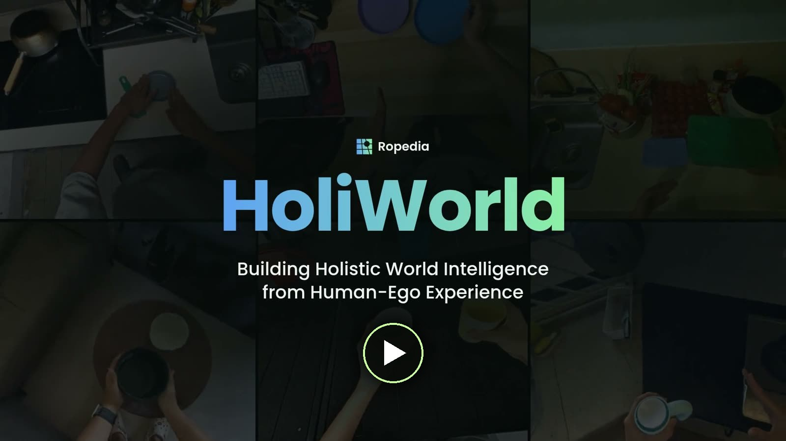
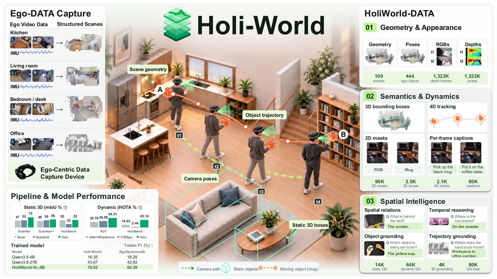
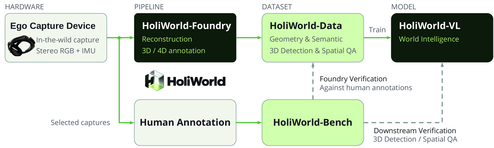
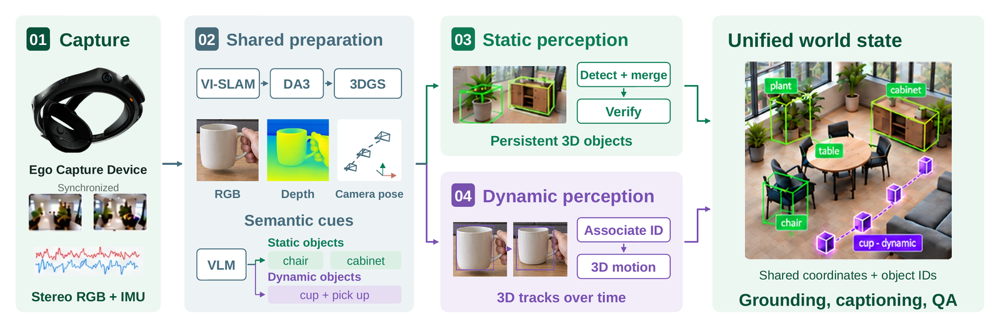

<div align="center">

# Holi-World: Building Holistic World Intelligence from Human-Ego Experience

Hao Li<sup>1,2*</sup>, Xiyuan Zheng<sup>1,2*</sup>, Yuanyuan Gao<sup>1,3*</sup>, Yalun Dai<sup>1,2</sup>, Xinhao Ji<sup>1,4</sup>, Xuan-Li Chen<sup>1</sup>, Jing Zhao<sup>1</sup>, Fangzhou Hong<sup>1</sup>, Zhaoxi Chen<sup>1</sup>, Ziwei Liu<sup>1,2†</sup>

<sup>1</sup>Ropedia &nbsp;&nbsp; <sup>2</sup>Nanyang Technological University &nbsp;&nbsp; <sup>3</sup>HKUST &nbsp;&nbsp; <sup>4</sup>Peking University

<sup>*</sup>Equal contribution &nbsp;&nbsp; <sup>†</sup>Corresponding author

<a href="https://ropedia.github.io/holi-world/"></a>

<a href="assets/holiworld_video.mp4"></a>


</div>

<p align="center">
  <a href="assets/holiworld_video.mp4"></a>
  <br>
  <em>Full project video (2 min). Click to open the MP4, or watch it on the <a href="https://ropedia.github.io/holi-world/">project page</a>.</em>
</p>

## News

- **2026/10**: Project page and full project video are online.
- **Coming soon**: arXiv paper, **HoliWorld-Data** and **HoliWorld-VL-4B** on Hugging Face.

## Introduction

Human egocentric experience shows how the world is organized and how it changes through
interaction. **Holi-World** is an integrated ecosystem that turns everyday egocentric
recordings into grounded learning resources, connecting experience capture, world
representation, automated data construction, model learning and independent evaluation.

- **HoliWorld-Foundry** combines complementary static and dynamic perception to build
  world records that link scene geometry, object semantics and interaction histories to
  their supporting observations.
- **HoliWorld-Data** organizes these records from about 100 self-collected scenes into
  grounded resources, including about 80K spatial-temporal QA pairs.
- **HoliWorld-VL-4B** is trained on HoliWorld-Data to test the learning value of the
  generated supervision.
- **HoliWorld-Bench** provides independent human annotations of held-out recordings for
  evaluating both annotation quality and learned spatial-temporal understanding.

<p align="center">
  
</p>

## Release

This repository hosts release information, the project video and links to the open
resources. **The HoliWorld-Foundry annotation pipeline code will not be open-sourced.**

| Resource | Contents | Status |
| --- | --- | --- |
| **HoliWorld-Data** | Egocentric recordings with geometry, 3D/4D object annotations, captions and spatial-temporal QA | 🤗 [`ropedia-ai/HoliWorld-Data`](https://huggingface.co/datasets/ropedia-ai/HoliWorld-Data) · coming soon |
| **HoliWorld-VL-4B** | Qwen3.5-4B fine-tuned on HoliWorld-Data | 🤗 [`ropedia-ai/HoliWorld-VL-4B`](https://huggingface.co/ropedia-ai/HoliWorld-VL-4B) · coming soon |
| Paper | Technical report | arXiv · coming soon |
| Project page and video | Website, full video and result clips | ✅ [online](https://ropedia.github.io/holi-world/) |
| HoliWorld-Foundry code | Annotation pipeline | Not open-sourced |

The final file layout, formats and license of each resource will be documented on its
Hugging Face page.

## Ecosystem

<p align="center">
  
</p>

An egocentric capture device records stereo RGB and IMU in the wild. HoliWorld-Foundry
reconstructs each scene and annotates static objects and dynamic tracks; HoliWorld-Data
turns these records into grounding, captioning and spatial-temporal QA supervision for
HoliWorld-VL. Independent human annotations form HoliWorld-Bench, which closes two
verification loops: annotation quality and downstream spatial understanding.

<p align="center">
  
</p>

## HoliWorld-Data

| Level | Contents |
| --- | --- |
| Raw data | ~100 scenes · 444 egocentric videos |
| Geometry | ~100 3DGS reconstructions · 1,322K RGB frames with depth maps and camera poses |
| Semantics | ~90K 2D boxes · 2,466 static 3D boxes · 2,095 dynamic 4D tracks |
| Spatial intelligence | ~4K 3D grounding annotations · ~80K captions · 13,647 static QA · 64,409 dynamic QA |

Every example keeps links to its source observations and annotations, so its target can
be traced to specific objects, times and frames. The QA pairs cover 30 types across
static mapping, dynamic trajectories and captions, including contrastive hard negatives.

## Results

**Downstream spatial-temporal reasoning (%).** Fine-tuning Qwen3.5-4B on HoliWorld-Data
alone surpasses zero-shot Qwen3.8-27B on every metric of both benchmarks.

| Benchmark | Metric | Qwen3.5-4B | Qwen3.8-27B (zero-shot) | **HoliWorld-VL-4B** |
| --- | --- | :-: | :-: | :-: |
| HoliWorld-Bench | Token F1 | 16.35 | 43.67 | **78.02** |
| HoliWorld-Bench | Yes/No acc. | 34.86 | 82.85 | **93.52** |
| HoliWorld-Bench | MCQ acc. | 62.00 | 75.00 | **94.00** |
| HoliWorld-Bench | Numerical acc. | 10.80 | 66.13 | **81.84** |
| EgoDynamic4D | Token F1 | 18.29 | 42.93 | **66.39** |
| EgoDynamic4D | Yes/No acc. | 59.47 | 61.07 | **99.67** |
| EgoDynamic4D | MCQ acc. | 79.16 | 57.54 | **94.92** |
| EgoDynamic4D | Numerical acc. | 0.02 | 0.16 | **16.33** |

**Annotation quality.** HoliWorld-Foundry against the strongest baseline in each setting.

| Task | Dataset | Metric | Strongest baseline | HoliWorld-Foundry |
| --- | --- | --- | :-: | :-: |
| Static 3D perception | ScanNet | AP<sub>25</sub> / AP<sub>50</sub> | 0.40 / 0.12 | **0.68 / 0.55** |
| Static 3D perception | ScanNet++ | AP<sub>25</sub> / AP<sub>50</sub> | 0.23 / 0.05 | **0.30 / 0.13** |
| Static 3D perception | HoliWorld-Bench | AP<sub>25</sub> / AP<sub>50</sub> | 0.16 / 0.07 | **0.24 / 0.12** |
| Dynamic tracking | Aria Digital Twin (20 seq.) | HOTA (%) | 36.00 | **54.31** |
| Dynamic tracking | HoliWorld-Bench | HOTA (%) | 15.13 | **43.14** |

The dynamic-tracking baselines use ground-truth information at test time (first-frame
masks or category queries); HoliWorld-Foundry uses none. Full tables are on the
[project page](https://ropedia.github.io/holi-world/#results).

## TODO

- [x] Publish the project page.
- [x] Release the full project video.
- [ ] Release the paper on arXiv.
- [ ] Release HoliWorld-Data on Hugging Face.
- [ ] Release HoliWorld-VL-4B on Hugging Face.

## Citation

If you find Holi-World useful, please cite:

```bibtex
@article{holiworld2026,
  title   = {Holi-World: Building Holistic World Intelligence from Human-Ego Experience},
  author  = {Li, Hao and Zheng, Xiyuan and Gao, Yuanyuan and Dai, Yalun and Ji, Xinhao and
             Chen, Xuan-Li and Zhao, Jing and Hong, Fangzhou and Chen, Zhaoxi and Liu, Ziwei},
  journal = {Ropedia Technical Report},
  year    = {2026}
}
```

## Repository layout

- `main`: release information, the project video and figures (this branch).
- [`page`](https://github.com/Ropedia/holi-world/tree/page): the project website, served at
  [ropedia.github.io/holi-world](https://ropedia.github.io/holi-world/).
